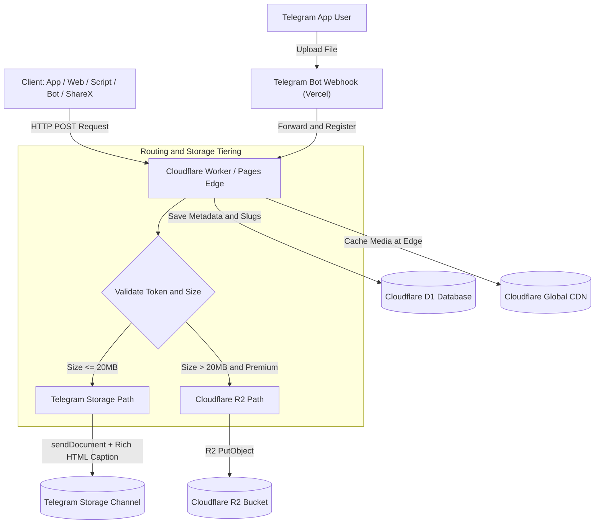

<div align="center">

# CommonThread Media Hosting

**High-performance, serverless universal media hosting engine and developer API built on Cloudflare Pages and Workers, backed by Telegram Cloud Storage, Cloudflare R2, and Cloudflare D1.**

[](LICENSE)
[](https://pages.cloudflare.com/)
[](https://developers.cloudflare.com/d1/)
[](https://developers.cloudflare.com/r2/)
[](https://core.telegram.org/bots/api)

<br/>

[**Web Uploader**](https://media-hosting.dhyeyp254.workers.dev/) • [**Pricing & Plans**](https://media-hosting.dhyeyp254.workers.dev/pricing) • [**Developer API Docs**](https://media-hosting.dhyeyp254.workers.dev/docs) • [**ShareX Config**](https://media-hosting.dhyeyp254.workers.dev/api/sharex) • [**Telegram Bot**](https://t.me/Imagehostssbot) • [**Deployment Guide**](#deployment-guide) • [**API Reference**](#developer-api-reference)

</div>

---

## Overview

**CommonThread** is an independent, serverless media hosting service equipped with a standard **Developer REST API**. It is built for developers who need to integrate high-speed file hosting directly into their applications, mobile apps, websites, cloud drives, Discord and Telegram bots, or automation scripts.

CommonThread supports **any file format** (Images, Videos, Audio, PDFs, text, scripts, archives, binaries, and documents) with native range streaming, global edge caching, and zero egress fees.

### Key Highlights

- **Universal Format Support**: Host images, audio, video, documents, scripts, archives, and binaries without arbitrary MIME-type restrictions.
- **Smart Cost-Optimized Storage**:
  - Files <= 20 MB are uploaded directly to **Telegram Cloud Storage** ($0 cost, high-speed CDN, unlimited storage).
  - Files > 20 MB (Premium Tier) are routed to **Cloudflare R2 Object Storage** (S3-compatible, zero egress fees).
- **Rich Telegram Metadata Captions**: Every file archived in Telegram includes an HTML caption with full metadata (filename, exact size, MIME type, upload source, auth tier, UTC & IST timestamps, direct link, slug ID, and delete token).
- **ImgBB API Compatibility**: Drop-in replacement endpoint (`POST /api/1/upload`) compatible with existing third-party uploaders, plugins, and ShareX.
- **Built-in Developer Token Management**: Generate, monitor, and instantly toggle API keys between **Free (20MB)** and **Premium (500MB)** directly from the `/admin` dashboard.
- **Security-First Architecture**: Anti-XSS attachment enforcement for executable scripts (`.bat`, `.sh`, `.exe`, `.html`, `.svg`), SSRF protection against private IP probing, and strict memory limits.
- **Zero Platform Coupling**: The engine is completely decoupled from downstream consumer applications and cloud drives. All authentication is standardized on `X-API-Key`.

---

## Architecture



---

## Feature Comparison

| Feature | Free Tier | Developer Pro (Premium) | Enterprise |
| :--- | :--- | :--- | :--- |
| **Price** | **$0 / forever** | **$9 / month** | **$29 / month** |
| **Max Single File Size** | **20 MB** | **500 MB** | **2 GB+** |
| **Storage Backend** | Telegram Cloud Storage | **Telegram** (<= 20MB) & **Cloudflare R2** (> 20MB) | Dedicated Cloudflare R2 Bucket |
| **Bandwidth / Egress** | Unlimited ($0) | Unlimited ($0) | Unlimited ($0) |
| **Seeking / Streaming** | Standard HTTP Range | High-Speed Native Edge Streaming | Dedicated Edge Route |
| **Rich Metadata Caption** | Included | Included | Included |
| **Token Prefix** | `ct_dev_...` | Priority `ct_dev_...` | Multi-token RBAC |
| **How to Request** | Instant via `/admin` | [Request via Email](mailto:dhyeyhosts@gmail.com) | [Contact Sales](mailto:dhyeyhosts@gmail.com) |

*Full interactive feature matrix available at [`/pricing`](https://media-hosting.dhyeyp254.workers.dev/pricing).*

---

## Developer API Reference

### 1. Primary Developer Upload (`POST /api/upload`)

Standard multipart upload endpoint for developers, consumer cloud drives, and external applications.

- **URL**: `https://<YOUR_DOMAIN>/api/upload`
- **Method**: `POST`
- **Authentication** *(any of the following)*:
  - Header: `X-API-Key: ct_dev_...`
  - Header: `Authorization: Bearer ct_dev_...`
  - Query parameter: `?key=ct_dev_...`
  - Form field: `key=ct_dev_...`

#### Parameters

| Field | Type | Description |
| :--- | :--- | :--- |
| `file` | `File` (Binary) | The file to upload (Image, PDF, Video, Audio, Script, Archive, etc.). |
| `url` | `String` *(optional)* | Remote URL to mirror/ingest directly into hosting. |
| `name` | `String` *(optional)* | Custom filename to assign to the uploaded file. |

#### Example Response (`200 OK`)
```json
{
  "success": true,
  "url": "https://media-hosting.dhyeyp254.workers.dev/1794851338016_im104h.pdf",
  "data": "https://media-hosting.dhyeyp254.workers.dev/1794851338016_im104h.pdf",
  "filename": "document.pdf",
  "size": 1048576,
  "size_formatted": "1.00 MB",
  "mime_type": "application/pdf",
  "storage": "telegram",
  "tier": "free",
  "delete_token": "del_a1b2c3d4e5f6...",
  "uploaded_at": "2026-11-17T05:45:28.476Z"
}
```

---

### 2. Direct Multipart Form Upload (`POST /upload`)

Direct file upload endpoint for browser GUIs and form submissions.

- **URL**: `https://<YOUR_DOMAIN>/upload`
- **Method**: `POST`
- **Headers**: `X-API-Key: ct_dev_...` *(optional if ENABLE_AUTH is false)*
- **Body**: `multipart/form-data` with `file`

#### Example Response (`200 OK`)
```json
{
  "success": true,
  "data": "https://media-hosting.dhyeyp254.workers.dev/1794894339932_icxbtv.txt",
  "url": "https://media-hosting.dhyeyp254.workers.dev/1794894339932_icxbtv.txt",
  "filename": "requirements.txt",
  "size": 32,
  "size_formatted": "32 B",
  "uploaded_on": "2026-11-17T05:45:39.932Z",
  "media_type": "text/plain",
  "storage_type": "telegram",
  "delete_token": "9b1deb4d-3b7d-4bad-9bdd-2b0d7b3dcb6d"
}
```

---

### 3. Remote URL Ingestion (`GET /hosturl?url=...`)

Download and mirror any file from an external URL directly into storage.

- **URL**: `https://<YOUR_DOMAIN>/hosturl?url=<ENCODED_REMOTE_URL>`
- **Method**: `GET`
- **Headers**: `X-API-Key: ct_dev_...` *(optional if ENABLE_AUTH is false)*

---

### 4. ImgBB Compatible Endpoint (`POST /api/1/upload`)

Drop-in replacement for software that integrates with ImgBB (such as **ShareX**, mobile apps, or CMS plugins).

- **URL**: `https://<YOUR_DOMAIN>/api/1/upload`
- **Method**: `POST`
- **Parameters**:
  - `key`: Developer API token.
  - `image`: Binary file or Base64-encoded string.

---

### 5. One-Click ShareX Integration (`GET /api/sharex`)

Visit `https://<YOUR_DOMAIN>/api/sharex` to download a pre-configured `.sxcu` destination file. Double-click to import it into ShareX for instant screenshot and screen-recording uploads.

---

## Code Examples

### Python (`requests`)
```python
import requests

API_URL = "https://media-hosting.dhyeyp254.workers.dev/api/upload"
API_KEY = "ct_dev_YOUR_TOKEN_HERE"

# Upload any file: .png, .pdf, .bat, .mp4, etc.
with open("report.pdf", "rb") as f:
    response = requests.post(
        API_URL,
        headers={"X-API-Key": API_KEY},
        files={"file": f}
    )

data = response.json()
if data.get("success"):
    print("Direct File URL:", data["url"])
else:
    print("Upload error:", data.get("error"))
```

### JavaScript / Node.js (`fetch`)
```javascript
const formData = new FormData();
formData.append('file', fileBlob, 'document.pdf');

const res = await fetch('https://media-hosting.dhyeyp254.workers.dev/api/upload', {
  method: 'POST',
  headers: {
    'X-API-Key': 'ct_dev_YOUR_TOKEN_HERE'
  },
  body: formData
});

const data = await res.json();
console.log('Direct URL:', data.url);
```

### cURL
```bash
curl -X POST https://media-hosting.dhyeyp254.workers.dev/api/upload \
  -H "X-API-Key: ct_dev_YOUR_TOKEN_HERE" \
  -F "file=@/path/to/any_file.pdf"
```

---

## Admin Dashboard & Token Management

Navigate to `https://<YOUR_DOMAIN>/admin` and log in with your credentials.

### Features
1. **Media Gallery**:
   - Preview all hosted images and video clips.
   - Batch deletion with multi-select.
   - One-click BBCode, Markdown, and Direct Link copying.
2. **Developer API Tokens Tab**:
   - **Issue New Tokens**: Set custom application name and initial tier (Free or Premium).
   - **One-Click Tier Toggle**: Click the tier badge on any token to instantly convert it between **Free (20MB)** and **Premium (500MB)**.
   - **Token Revocation**: Disable compromised tokens immediately.
   - **Upload Counter**: Track lifetime uploads made with each token.

---

## Environment Variables Reference

### Cloudflare Worker / Pages Environment

Configure these in the Cloudflare Dashboard under **Workers & Pages > Settings > Variables and Secrets**:

| Variable | Type | Required | Description |
| :--- | :--- | :--- | :--- |
| `DATABASE` | D1 Binding | **Yes** | Cloudflare D1 Database binding named `DATABASE`. |
| `TG_BOT_TOKEN` | Secret | **Yes** | Telegram Bot Token obtained from [@BotFather](https://t.me/BotFather). |
| `TG_CHAT_ID` | Secret | **Yes** | Telegram Private Channel / Group ID used for storage backup. |
| `USERNAME` | Variable | **Yes** | Admin dashboard username (default: `admin`). |
| `PASSWORD` | Secret | **Yes** | Admin dashboard password. |
| `DOMAIN` | Variable | Optional | Public domain (e.g. `media-hosting.dhyeyp254.workers.dev`). |
| `R2_BUCKET` | R2 Binding | Optional | Cloudflare R2 bucket binding named `R2_BUCKET` for files > 20MB. |
| `API_KEY` | Secret | Optional | Legacy global API key (if set, unauthenticated uploads are blocked). |

---

## Deployment Guide

### Cloudflare Worker Deployment Options

There are two common deployment workflows for the Cloudflare Worker:

1. **Option A: GitHub Git Integration (Automatic)**
   - If your Cloudflare Worker or Pages project is linked directly to your GitHub repository (`Image-Hosting`, branch `cloudflare`):
   - Every `git push origin cloudflare` automatically triggers Cloudflare to build and deploy your worker.
   - You do **not** need to manually copy code or edit in Cloudflare Dashboard.

2. **Option B: Manual Cloudflare Dashboard / Wrangler**
   - If you deployed by creating a Worker directly inside the Cloudflare Dashboard without Git integration:
   - Navigate to **Workers & Pages > your-worker > Quick Edit (or Edit Code)**.
   - Copy the latest code from `_worker.js` and paste it into the editor, then click **Save and Deploy**.
   - Alternatively, deploy via Wrangler CLI:
     ```bash
     npx wrangler deploy
     ```

---

## Contact & Support

For questions, enterprise plans, or to request a Developer API key:
- **Email**: [dhyeyhosts@gmail.com](mailto:dhyeyhosts@gmail.com)
- **Request Key Portal**: [https://media-hosting.dhyeyp254.workers.dev/request-api](https://media-hosting.dhyeyp254.workers.dev/request-api)
- **Enterprise Inquiry**: [https://media-hosting.dhyeyp254.workers.dev/contact](https://media-hosting.dhyeyp254.workers.dev/contact)

---

## License

This project is licensed under the [MIT License](LICENSE).
