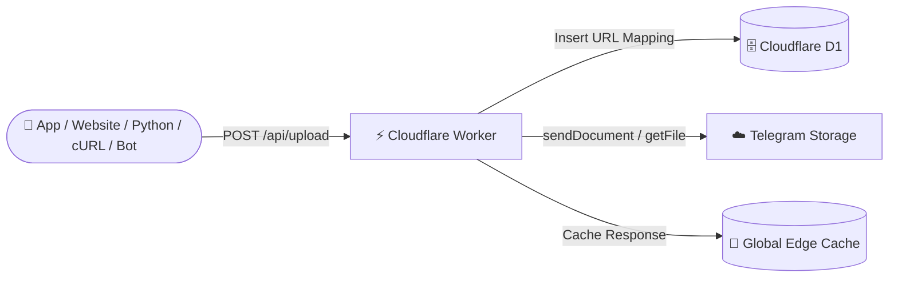

<div align="center">

# 🚀 CommonThread

**A high-performance, serverless universal media hosting platform & developer API built on Cloudflare Pages/Workers, backed by Telegram Cloud Storage and Cloudflare D1.**

[](LICENSE)
[](https://pages.cloudflare.com/)
[](https://developers.cloudflare.com/d1/)
[](https://core.telegram.org/bots/api)

<br/>

[**Web Uploader**](https://media-hosting.dhyeyp254.workers.dev/) • [**Pricing & Plans**](https://media-hosting.dhyeyp254.workers.dev/pricing) • [**Developer API Docs**](https://media-hosting.dhyeyp254.workers.dev/docs) • [**ShareX Config**](https://media-hosting.dhyeyp254.workers.dev/api/sharex) • [**Telegram Bot**](https://t.me/Imagehostssbot) • [**Deployment Guide**](#-deployment-guide) • [**Developer API Reference**](#-developer-api-reference)

</div>

---

## 📖 Overview

**CommonThread** provides a free, unlimited cloud file and media hosting service with a dedicated **Developer API**. It allows developers to integrate file uploads directly into their own applications, websites, bots, and tools for **any file format** (Images, PDFs, Videos, Audio, `.txt`, `.bat`, `.sh`, documents, archives, etc.).

Powered by **Cloudflare Workers / Pages** at the edge and **Cloudflare D1 (Serverless SQLite)** for metadata indexing, CommonThread delivers instant uploads, global edge caching, and direct file delivery.

---

## 🏗️ Architecture



* **Core Engine (Cloudflare)**: Runs `_worker.js` on Cloudflare Workers/Pages with D1 database binding, handling media ingestion, range streaming, edge caching, and developer APIs.
* **Telegram Storage**: Private Telegram channel used as a high-capacity, zero-cost storage backend.
* **Telegram Bot (Vercel)**: Runs `api/index.py` on Vercel as a webhook to let Telegram users upload files directly from Telegram chat and receive direct hosting URLs.

---

## ✨ Features

- ⚡ **Developer-First API (`POST /api/upload`)**: Upload any file from your own apps, websites, or scripts with one HTTP call.
- 📁 **Universal Format Support**: Host any file type:
  - **Images**: `.png`, `.jpg`, `.jpeg`, `.gif`, `.webp`, `.svg`, `.bmp`, `.ico`
  - **Documents**: `.pdf`, `.docx`, `.xlsx`, `.pptx`, `.txt`, `.csv`
  - **Scripts & Code**: `.bat`, `.cmd`, `.sh`, `.ps1`, `.py`, `.js`, `.json`, `.xml`, `.log`
  - **Videos & Audio**: `.mp4`, `.webm`, `.mp3`, `.wav` (with native HTTP `Range` streaming)
  - **Archives & Binaries**: `.zip`, `.rar`, `.7z`, `.exe`, `.msi`, `.apk`
- 🚀 **Global Edge Caching**: Sub-millisecond media delivery via Cloudflare Edge Cache.
- 🔒 **Security Hardened**:
  - **Anti-XSS**: Script and executable files (`.bat`, `.sh`, `.exe`, `.html`, `.svg`) are served as direct attachments on the web to prevent Stored XSS.
  - **SSRF Hardened**: Remote URL ingestion validates protocols and blocks loopback, private IPv4 subnets, and cloud metadata IPs.
  - **OOM Defense**: Size checked prior to memory buffering.
- 🤖 **Telegram Bot Integration**: Deploy the Flask webhook on Vercel to allow direct Telegram uploads.

---

## 📡 Developer API Reference

### Upload File (`POST /api/upload`)

Upload any file from your app or project to get a direct hosted URL.

- **Endpoint**: `https://<YOUR_DOMAIN>/api/upload`
- **Method**: `POST`
- **Headers**:
  - `Content-Type: multipart/form-data`
  - `X-API-Key: <YOUR_DEVELOPER_TOKEN>` *(or Bearer token in `Authorization: Bearer <YOUR_DEVELOPER_TOKEN>`, or query `?key=<YOUR_DEVELOPER_TOKEN>`)*
- **Parameters**:
  - `file`: The binary file to upload (any format: image, pdf, .txt, .bat, audio, video).
  - *(or JSON body with `{"url": "https://example.com/file.png"}` for remote URL mirroring)*

#### Response (`200 OK`)
```json
{
  "success": true,
  "url": "https://media-hosting.dhyeyp254.workers.dev/1794851338016_im104h.bat",
  "filename": "my_script.bat",
  "size": 1024,
  "size_formatted": "1.00 KB",
  "mime_type": "application/x-bat",
  "uploaded_at": "2026-11-16T17:48:00.000Z"
}
```

---

### 🔑 Issuing & Managing Developer API Tokens

You can issue tokens to other developers so they can use your platform in their apps, bots, or websites:

1. Go to your Admin Dashboard (`https://<YOUR_DOMAIN>/admin`).
2. Click on the **"🔑 Developer API Tokens"** tab.
3. Enter the developer or app name (e.g. `Client Mobile App`, `Discord Bot`), choose the tier (**Free 20MB** or **Premium 500MB**), and click **"Generate API Token"**.
4. Copy the generated key (e.g. `ct_dev_...`) and hand it to the developer! Developers pass this token with their requests using:
   - Header: `X-API-Key: YOUR_TOKEN`
   - Header: `Authorization: Bearer YOUR_TOKEN`
   - Query: `?key=YOUR_TOKEN`
   - Form-data: `key=YOUR_TOKEN`
5. **One-Click Tier Toggle**: In the Active Tokens table, click on the **Plan Tier badge** for any token to switch it instantly between **Free** and **Premium** at any time.

---

### 💳 Plans & Storage Tiers

| Feature | ⚡ Free Tier | 👑 Developer Pro (Premium) | 🏢 Enterprise |
| :--- | :--- | :--- | :--- |
| **Price** | **$0 / forever** | **$9 / month** | **$29 / month** |
| **Max Single File** | **20 MB** | **500 MB** | **2 GB+** |
| **Storage Backend** | Telegram Cloud Storage | **Cloudflare R2** (S3-compatible) | Dedicated Cloudflare R2 Bucket |
| **Bandwidth / Egress** | Unlimited ($0) | Unlimited ($0) | Unlimited ($0) |
| **Seeking / Streaming** | Standard Range | High-Speed Native Edge Streaming | Dedicated Edge Route |
| **Token Format** | `ct_dev_...` | Priority `ct_dev_...` | Multi-token RBAC |
| **How to Request** | Instant via `/admin` | Email [dhyeyp254@gmail.com](mailto:dhyeyp254@gmail.com) | Contact Sales |

*View the full interactive comparison at [`/pricing`](https://media-hosting.dhyeyp254.workers.dev/pricing).*

---

### Integration Examples

#### 1. Python (`requests`)
```python
import requests

url = "https://media-hosting.dhyeyp254.workers.dev/api/upload"
headers = {"X-API-Key": "YOUR_DEVELOPER_TOKEN"}

# Upload any file: .bat, .pdf, .png, .txt, etc.
with open("my_script.bat", "rb") as f:
    response = requests.post(url, headers=headers, files={"file": f})

data = response.json()
if data["success"]:
    print("Direct File URL:", data["url"])
else:
    print("Upload Failed:", data["error"])
```

#### 2. JavaScript / Node.js (`fetch`)
```javascript
const formData = new FormData();
formData.append("file", fileInput.files[0]);

const response = await fetch("https://media-hosting.dhyeyp254.workers.dev/api/upload", {
  method: "POST",
  headers: {
    "X-API-Key": "YOUR_DEVELOPER_TOKEN"
  },
  body: formData
});

const data = await response.json();
console.log("Direct File URL:", data.url);
```

#### 3. cURL
```bash
curl -X POST https://media-hosting.dhyeyp254.workers.dev/api/upload \
  -H "X-API-Key: YOUR_DEVELOPER_TOKEN" \
  -F "file=@/path/to/any_file.pdf"
```

#### 4. PHP
```php
<?php
$ch = curl_init();
curl_setopt($ch, CURLOPT_URL, "https://media-hosting.dhyeyp254.workers.dev/api/upload");
curl_setopt($ch, CURLOPT_HTTPHEADER, ["X-API-Key: YOUR_DEVELOPER_TOKEN"]);
curl_setopt($ch, CURLOPT_POST, true);
curl_setopt($ch, CURLOPT_POSTFIELDS, [
    "file" => new CURLFile("/path/to/document.pdf")
]);
curl_setopt($ch, CURLOPT_RETURNTRANSFER, true);

$data = json_decode(curl_exec($ch), true);
curl_close($ch);

echo "Direct File URL: " . $data["url"];
?>
```

---

## 🚀 Deployment Guide

### Cloudflare Deployment (Core Media Host & API)

1. **Create D1 Database** in Cloudflare Dashboard:
   - Name: `ar_hosting_db`
   - Console command:
     ```sql
     CREATE TABLE IF NOT EXISTS media (
       url TEXT PRIMARY KEY,
       fileId TEXT NOT NULL,
       filename TEXT,
       file_size INTEGER DEFAULT 0,
       mime_type TEXT DEFAULT '',
       created_at INTEGER DEFAULT 0,
       delete_token TEXT DEFAULT ''
     );
     ```
2. **Deploy to Cloudflare Pages**:
   - Connect your GitHub repository.
   - Build command: *(leave blank)*
   - Build output directory: `/`
3. **Environment Variables**:
   - `DOMAIN`: Your worker/pages domain (e.g. `media-hosting.dhyeyp254.workers.dev`).
   - `TG_BOT_TOKEN`: Telegram bot token from `@BotFather`.
   - `TG_CHAT_ID`: Telegram channel ID for backup storage.
   - `DATABASE`: D1 Database binding named `DATABASE`.
   - `USERNAME`: Admin username for `/admin`.
   - `PASSWORD`: Admin password for `/admin`.
   - `API_KEY` *(optional)*: Key to restrict developer uploads (if left blank, API is open).

---

### Vercel Deployment (Telegram Bot Webhook)

1. Connect repository to Vercel.
2. In Vercel Project Settings, set Environment Variables:
   - `TG_BOT_TOKEN`: Bot token from `@BotFather`.
   - `TG_CHAT_ID`: Telegram channel ID.
   - `CF_DOMAIN`: Your Cloudflare Worker domain (e.g. `media-hosting.dhyeyp254.workers.dev`).
   - `CF_USERNAME`: `admin` (or your worker username).
   - `CF_PASSWORD`: Your worker password.
3. Set your Telegram bot webhook to:
   `https://<your-vercel-app>.vercel.app/webhook`
4. Send any file or media to your Telegram bot; it will upload it to your Cloudflare hosting engine and reply with the direct link!

---

## 📄 License

MIT License.
